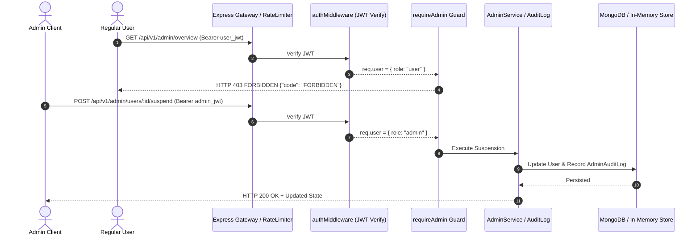

# ARTISTRY AI — ADMIN DASHBOARD & MANAGEMENT ECOSYSTEM
**Phase 6 Architecture & Operational Guide**  
*Document Version: 1.0.0 — Production Specification*

---

## 1. Executive Summary

The **Admin Dashboard & Management Ecosystem** provides operators and administrators of ARTISTRY AI with secure, auditable, and comprehensive control over:
- System health and real-time operational metrics.
- Financial overview (Monthly Recurring Revenue / Annual Run Rate).
- User lifecycle management (search, inspection, suspension, privilege modification).
- AI credit monitoring, grants, and manual balance corrections.
- AI feature analytics and utilization distribution.
- Complete regulatory and forensic audit logging.

Administrative operations are strictly isolated behind cryptographic JWT verification and role-based access control (RBAC), ensuring non-administrative clients receive HTTP 403 `FORBIDDEN` status.

---

## 2. Security Architecture & Role Enforcement



### Security Guardrails
1. **RBAC Guard (`requireAdmin`)**: Every `/api/v1/admin/*` endpoint executes `authMiddleware(true)` followed by `requireAdmin`. If `req.user.role !== 'admin'`, request is halted with HTTP 403.
2. **Self-Suspension Protection**: An administrator cannot suspend their own user account (`CANNOT_SUSPEND_SELF`), preventing accidental administrative lockouts.
3. **Immutable Audit Trails**: Every state-changing administrative action (`USER_SUSPEND`, `USER_UNSUSPEND`, `CREDIT_ADJUST`, `ROLE_CHANGE`) generates a timestamped `AdminAuditLog` record containing the operator ID, target user ID, IP address, and payload delta.
4. **Non-Escalatable Public Endpoints**: Regular user profile updates (`PUT /api/v1/user/profile`) strip `role`, `creditBalance`, `subscriptionTier`, and `isSuspended` to ensure client manipulation cannot bypass RBAC.

---

## 3. Administrative REST Endpoints Reference

All endpoints are mounted under `/api/v1/admin` and require header:
```http
Authorization: Bearer <admin_jwt>
```

### 3.1 `GET /api/v1/admin/overview`
Retrieves consolidated business and infrastructure metrics.

**Response (HTTP 200 OK):**
```json
{
  "success": true,
  "data": {
    "overview": {
      "totalUsers": 1420,
      "activeUsersLast30Days": 985,
      "subscriptionDistribution": {
        "free": 1150,
        "pro": 210,
        "premium": 60
      },
      "financials": {
        "estimatedMonthlyRecurringRevenueUsd": 3297.30,
        "estimatedAnnualRunRateUsd": 39567.60,
        "currency": "USD"
      },
      "credits": {
        "totalCirculationBalance": 184500,
        "totalCreditsConsumedAllTime": 42100
      },
      "systemHealth": {
        "uptimeSeconds": 86400,
        "nodeVersion": "v24.19.0",
        "memoryRssMb": 148,
        "databaseMode": "connected",
        "timestamp": "2026-11-09T17:25:00.000Z"
      }
    }
  }
}
```

---

### 3.2 `GET /api/v1/admin/users`
Searches and paginates through registered accounts.

**Query Parameters:**
| Parameter | Type | Default | Description |
| :--- | :--- | :--- | :--- |
| `query` | `string` | — | Substring search matching `email` or `displayName` |
| `tier` | `string` | — | Filter by plan: `free`, `pro`, `premium` |
| `role` | `string` | — | Filter by role: `user`, `artist`, `admin` |
| `isSuspended` | `boolean` | — | Filter by account suspension status (`true` / `false`) |
| `page` | `number` | `1` | Page number (1-based) |
| `limit` | `number` | `20` | Items per page (max 100) |

**Response (HTTP 200 OK):**
```json
{
  "success": true,
  "data": {
    "users": [
      {
        "userId": "c7a8b3d1-9f22-4801-b844-0de1b938f411",
        "email": "artist.jane@example.com",
        "displayName": "Jane Doe",
        "role": "artist",
        "subscriptionTier": "pro",
        "creditBalance": 500,
        "isSuspended": false,
        "suspensionReason": null,
        "isEmailVerified": true,
        "experienceMode": "professional",
        "language": "en",
        "createdAt": "2026-10-15T08:30:00.000Z",
        "updatedAt": "2026-11-08T12:00:00.000Z"
      }
    ],
    "pagination": {
      "page": 1,
      "limit": 20,
      "total": 1,
      "totalPages": 1
    }
  }
}
```

---

### 3.3 `GET /api/v1/admin/users/:userId`
Fetches a single user's 360-degree profile including active subscriptions, ledger history, and administrative audit records.

**Response (HTTP 200 OK):**
```json
{
  "success": true,
  "data": {
    "user": { ... },
    "subscription": {
      "subscriptionId": "sub_a1b2c3d4",
      "planId": "pro",
      "tier": "pro",
      "status": "active",
      "billingCycle": "monthly",
      "currentPeriodEnd": "2026-12-09T00:00:00.000Z",
      "cancelAtPeriodEnd": false
    },
    "creditHistory": [
      {
        "transactionId": "tx_998877",
        "amount": -5,
        "balanceAfter": 495,
        "type": "usage",
        "featureId": "drawing_critique",
        "timestamp": "2026-11-09T10:00:00.000Z"
      }
    ],
    "auditHistory": [
      {
        "logId": "audit_1234",
        "adminUserId": "admin_uuid",
        "action": "CREDIT_ADJUST",
        "details": { "amount": 100, "reason": "Support issue compensation" },
        "timestamp": "2026-11-08T09:00:00.000Z"
      }
    ]
  }
}
```

---

### 3.4 `POST /api/v1/admin/users/:userId/suspend`
Suspends or reactivates a user account. Suspended accounts are rejected during login and authentication.

**Request Body:**
```json
{
  "isSuspended": true,
  "reason": "Payment dispute investigation"
}
```

**Response (HTTP 200 OK):**
```json
{
  "success": true,
  "data": {
    "user": {
      "userId": "c7a8b3d1-9f22-4801-b844-0de1b938f411",
      "isSuspended": true,
      "suspensionReason": "Payment dispute investigation"
    },
    "message": "User suspended successfully"
  }
}
```

---

### 3.5 `POST /api/v1/admin/users/:userId/credits`
Manually adjusts user credit balances with credit transaction ledger recording and audit tracking.

**Request Body:**
```json
{
  "amount": 100,
  "reason": "Art competition reward"
}
```

**Response (HTTP 200 OK):**
```json
{
  "success": true,
  "data": {
    "userId": "c7a8b3d1-9f22-4801-b844-0de1b938f411",
    "amount": 100,
    "previousBalance": 50,
    "newBalance": 150,
    "reason": "Art competition reward"
  }
}
```

---

### 3.6 `POST /api/v1/admin/users/:userId/role`
Promotes or demotes an account's authorization tier.

**Request Body:**
```json
{
  "role": "artist"
}
```

---

### 3.7 `GET /api/v1/admin/analytics/ai`
Aggregates AI usage across drawing features.

**Response (HTTP 200 OK):**
```json
{
  "success": true,
  "data": {
    "totalAICalls": 412,
    "totalCreditsSpent": 2180,
    "featureBreakdown": {
      "sketch_convert": { "calls": 120, "creditsSpent": 600 },
      "drawing_critique": { "calls": 95, "creditsSpent": 475 },
      "mentor_chat": { "calls": 150, "creditsSpent": 450 },
      "lighting_study": { "calls": 47, "creditsSpent": 655 }
    },
    "timestamp": "2026-11-09T17:26:00.000Z"
  }
}
```

---

### 3.8 `GET /api/v1/admin/audit-logs`
Retrieves chronological administrative audit trails.

**Query Parameters:**
- `limit` (optional): Maximum records to retrieve (default: 100, max: 500).

---

## 4. Verification & Testing Evidence

All admin capabilities are rigorously tested in `backend/tests/admin.test.ts`:
- **Guard Enforcement**: Non-admins and unauthenticated users receive 401/403.
- **Self-Protection**: Administrator attempting self-suspension receives 400 `CANNOT_SUSPEND_SELF`.
- **Ledger Invariance**: Credit adjustments write both a `CreditTransaction` (`type: "admin_adjustment"`) and an `AdminAuditLog` (`action: "CREDIT_ADJUST"`).
- **Execution Result**: 14 tests passed, 0 failures.
