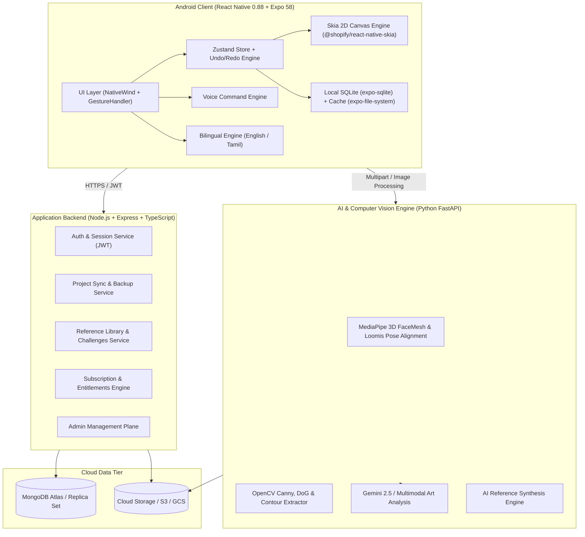

# ARTISTRY AI — System Architecture Specification

## 1. Executive Architecture Overview

**ARTISTRY AI** is engineered as a modern, native-first, high-performance drawing and digital art education ecosystem. Unlike hybrid WebView wrappers, ARTISTRY AI utilizes a genuine native React Native runtime powered by Skia C++ rendering and hardware acceleration on Android, coupled with an offline-first SQLite database, a scalable Node.js/Express application service, and a Python FastAPI Computer Vision & AI microservice.

---

## 2. Tier Specifications

### 2.1 Native Android Client
- **Runtime:** React Native 0.88.1 with Hermes JavaScript engine and New Architecture (Fabric + TurboModules).
- **Framework:** Expo SDK 58 with Expo Router file-based routing.
- **Rendering Engine:** `@shopify/react-native-skia` 2.14.0 running directly on Android `TextureView` for 60fps vector path rendering, alpha blending, and image shader processing.
- **Gesture Engine:** `react-native-gesture-handler` 3.3.0 running simultaneous Pan and Pinch gestures for smooth zooming (0.4x to 6.0x), translation, and zero-latency drawing.
- **Local Persistence:** `expo-sqlite` 58.0.15 in Write-Ahead-Logging (WAL) mode storing relational project metadata, layer snapshots, and reference indices.
- **File System:** `expo-file-system` and `expo-image-manipulator` maintaining a non-destructive image cache where imported originals are never altered, and all edits operate on private working copies.
- **Styling:** `nativewind` 4.2.7 and `tailwindcss` 3.4.17 with an art-studio palette (Paper `#FFFEFA`, Moss Green `#244E41`, Terracotta `#D27B5C`, Warm Gold `#E3BE63`, Charcoal `#17201C`).

### 2.2 Node.js & Express Backend Service
- **Role:** Central business logic, authentication, subscription enforcement, project cloud backups, and community content distribution.
- **Framework:** Node.js 24 LTS, Express, TypeScript, Mongoose.
- **Security:** Argon2 / bcrypt password hashing, JWT with short-lived access tokens and sliding refresh tokens, helmet security headers, rate limiting.
- **Key Modules:**
  - `auth`: Signup, login, password recovery, guest-to-cloud account migration.
  - `projects`: Delta sync for drawing strokes and canvas states.
  - `library`: Categorized copyright-free drawing references.
  - `challenges`: Daily timed drawing prompts and streak telemetry.
  - `subscriptions`: Google Play Billing verification and tier entitlement tokens.
  - `admin`: Role-based dashboard for curriculum and content curation.

### 2.3 Python FastAPI AI & Computer Vision Engine
- **Role:** Compute-heavy image processing, anatomical landmark extraction, 3D pose estimation, and generative drawing guidance.
- **Framework:** Python 3.12+, FastAPI, Uvicorn, Pydantic v2.
- **Vision Libraries:**
  - `OpenCV (cv2)`: Grayscale luminance extraction, adaptive thresholding, Difference of Gaussians (DoG) for pencil sketch conversion, morphological cleanups.
  - `MediaPipe FaceMesh`: 468 3D facial landmarks for calculating head yaw, pitch, roll, cranium center, jawline contour, and facial thirds to power the 8-stage Loomis Studio.
  - `Google GenAI SDK (Gemini)`: Multimodal artwork analysis, constructive critique, and text-to-reference generation.

### 2.4 Cloud Data Storage (MongoDB)
- **Database:** MongoDB with structured collections for `users`, `projects`, `references`, `challenges`, `subscriptions`, and `audit_logs`.
- **Hybrid Storage Model:** Heavy project stroke histories and image assets are stored as compressed binary payloads with metadata indices in MongoDB, while local copies remain accessible offline in SQLite.

---

## 3. Storage & Privacy Guarantees

1. **Zero-Implicit-Upload:** Selecting an image from the Android gallery, camera, or file picker stores the file exclusively in the client's internal sandbox. No network traffic is initiated upon image selection.
2. **Offline-First Functionality:** Blank drawing canvas, brushes, layers, undo/redo, local photo adjustments, Smart Grid, local Tracing, and local Color Studio function 100% offline without an active internet connection or user account.
3. **Explicit AI Consent:** AI analysis and cloud generation are triggered only when the user explicitly taps an AI action button, with clear indicators of what data is transmitted.
4. **Working-Copy Non-Destructive Editing:** Original reference photos are never overwritten. Edits (crop, rotate, resize) generate isolated working-copy files in `references/` cache.

---

## 4. Multi-Language (Tamil & English) & Voice Architecture

1. **Bilingual Catalogs:** UI strings, error messages, and instructional prompts are mapped in key-value JSON trees (`en.json` and `ta.json`).
2. **Tamil Typography:** Fonts and layout constraints accommodate Tamil script (தமிழ்) glyph metrics without vertical truncation.
3. **Voice Command Pipeline:**
   - Client captures speech input.
   - Dual-language intent parser recognizes drawing commands (e.g., "pen", "erase", "undo", "layer", "zoom") in both English and Tamil equivalents ("பென்சில்", "அழி", "முந்தைய செயல்", "அடுக்கு").
   - Dispatches deterministic action events to the Zustand store.

---

*Last Updated: 2026-11-04*
