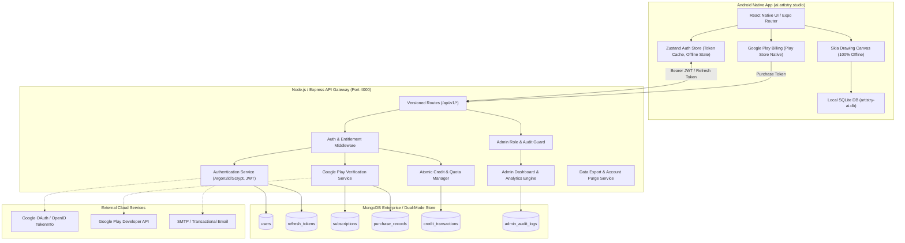

# ARTISTRY AI — PHASE 6 ARCHITECTURE PLAN
**Phase:** Phase 6 — Authentication, Subscription, Monetization & Admin Ecosystem  
**Target Platform:** Android Native (`ai.artistry.studio`), Node.js (v24), Python (3.12 / FastAPI), MongoDB  
**Authoritative Specification:** Phase 6 Prompt  
**Status:** Approved & Initialized  

---

## 1. System Architecture Overview



---

## 2. Core Architectural Principles

1. **Uncompromised Offline Drawing:** The core drawing studio, Loomis guides, perspective assistant, shading sphere, local references, and local OpenCV features must remain 100% operational when logged out or offline.
2. **Server-Authoritative Entitlements & Credits:** The Android client cannot dictate its own subscription tier, credit balance, or purchase validity. All protected features are validated server-side.
3. **Cryptographic Purchase Verification:** Client-reported purchase success is treated as unverified until cryptographically validated against the Google Play Developer API.
4. **Idempotency & Atomic Deductions:** Every credit deduction and purchase token validation uses unique idempotency keys and atomic updates to prevent double-spending or replay attacks.
5. **Privacy by Design:** Strict zero-implicit-upload guarantees are maintained. User data export and compliant account deletion workflows are provided.

---

## 3. Database Schema Design (MongoDB)

### 3.1 `User` Collection (`users`)
```typescript
interface IUser {
  userId: string; // Unique UUID
  email: string; // Unique, indexed
  passwordHash?: string; // Scrypt/Argon2id formatted hash
  displayName: string;
  avatarUrl?: string;
  role: "user" | "artist" | "admin";
  experienceMode: "beginner" | "professional";
  language: "en" | "ta";
  isEmailVerified: boolean;
  isSuspended: boolean;
  suspensionReason?: string;
  creditBalance: number; // Current available balance
  subscriptionTier: "free" | "pro" | "premium";
  drawingPreferences: {
    defaultBrush: string;
    smoothing: string;
    autoSaveIntervalMs: number;
  };
  createdAt: Date;
  updatedAt: Date;
}
```

### 3.2 `RefreshToken` Collection (`refresh_tokens`)
```typescript
interface IRefreshToken {
  tokenId: string;
  tokenHash: string; // SHA-256 of opaque token
  userId: string;
  deviceId?: string;
  ipAddress?: string;
  userAgent?: string;
  expiresAt: Date;
  isRevoked: boolean;
  replacedByTokenHash?: string;
  createdAt: Date;
}
```

### 3.3 `Subscription` Collection (`subscriptions`)
```typescript
interface ISubscription {
  subscriptionId: string;
  userId: string; // Indexed
  tier: "free" | "pro" | "premium";
  status: "active" | "canceled" | "expired" | "grace_period";
  billingCycle: "monthly" | "yearly";
  productId: string;
  purchaseToken: string;
  orderId: string;
  startDate: Date;
  currentPeriodStart: Date;
  currentPeriodEnd: Date;
  cancelAtPeriodEnd: boolean;
  canceledAt?: Date;
  gracePeriodExpiresAt?: Date;
  updatedAt: Date;
}
```

### 3.4 `PurchaseRecord` Collection (`purchase_records`)
```typescript
interface IPurchaseRecord {
  orderId: string;
  userId: string;
  productId: string;
  purchaseToken: string; // Unique index to prevent duplicate credit/subscription grant
  purchaseTime: Date;
  verificationStatus: "verified" | "failed" | "duplicate";
  rawVerificationResponse?: Record<string, any>;
  environment: "production" | "sandbox" | "test";
  createdAt: Date;
}
```

### 3.5 `CreditTransaction` Collection (`credit_transactions`)
```typescript
interface ICreditTransaction {
  transactionId: string;
  userId: string; // Indexed
  amount: number; // e.g., +500 (monthly) or -5 (analysis)
  balanceAfter: number;
  type: "monthly_allocation" | "purchase" | "usage" | "refund" | "admin_adjustment";
  featureId?: string;
  idempotencyKey?: string; // Unique sparse index
  jobId?: string;
  description: string;
  timestamp: Date;
}
```

### 3.6 `AdminAuditLog` Collection (`admin_audit_logs`)
```typescript
interface IAdminAuditLog {
  logId: string;
  adminUserId: string;
  action: string;
  targetUserId?: string;
  details: Record<string, any>;
  ipAddress?: string;
  timestamp: Date;
}
```

---

## 4. Execution Roadmap (Group-by-Group)

- **Group A (Auth & User Profiles):**
  - Registration with password strength & terms consent.
  - Login via Email/Password & Google Sign-In.
  - Scrypt password hashing with unique salt.
  - JWT Access token (15m) + rotating Refresh tokens (30d).
  - Password reset tokens & account recovery.
  - User profile editing, avatar, preferences, and session revocation.
  - Client auth state persistence in SQLite + Zustand.

- **Group B (Subscription Plans & Entitlements):**
  - Configurable 3-tier catalog: Free, Pro, Premium.
  - Entitlement evaluation engine on backend.
  - Access control middleware rejecting unauthorized tier requests.
  - Tier upgrade/downgrade logic, expiration, and grace-period handling.

- **Group C (Google Play Billing & Purchase Verification):**
  - Android native Google Play Billing interface.
  - Secure `/api/v1/billing/verify-purchase` endpoint.
  - Cryptographic token verification via Google Play Developer API.
  - Package name, product ID, and duplicate token prevention.
  - Graceful handling of missing Google Play credentials (`NOT_CONFIGURED` state).

- **Group D (AI Credits & Usage Management):**
  - Configurable credit costs per feature.
  - Server-side atomic deductions with idempotency keys.
  - Automatic refunds for eligible failed AI jobs.
  - Monthly allowance replenishment.
  - Offline drawing immunity (never blocked by 0 balance).

- **Group E (Admin Dashboard):**
  - Role-based authorization (`role === "admin"`).
  - Metrics overview: users, active subscriptions, credit consumption, system health.
  - User management: search, filter, suspend, adjust credits.
  - Audit log for privileged actions.

- **Group F (Privacy, Data Export, Deletion & Notifications):**
  - GDPR/CCPA compliant data export (`GET /api/v1/user/export-data`).
  - Account deletion workflow with re-authentication and asset purge.
  - Configurable email notification triggers and in-app alerts.

- **Group G (Security Testing, Integration Testing & Android Verification):**
  - Automated test suite covering auth, subscriptions, credits, and admin.
  - Android UI integration & emulator smoke test.
  - Final Phase 6 documentation and completion report.
