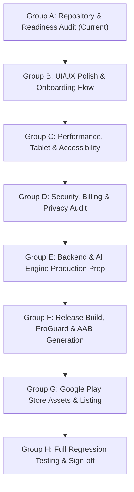

# ARTISTRY AI — PHASE 7 ARCHITECTURE PLAN
**Final Production Release, UI/UX Polish, Android Packaging & Google Play Store Launch**  
*Document Version: 1.0.0 — Authoritative Phase 7 Specification*  
*Timestamp: 2026-11-09T17:55:00+05:30*  
*Application Package: `ai.artistry.studio` | Workspace: `d:\antigravity\artist ai app`*

---

## 1. Executive Mission & Strategic Scope

Phase 7 is the final production milestone for **ARTISTRY AI**. Its objective is to transform the existing fully functional application (Phases 1–6) into an exceptional, battle-tested, secure, and production-ready Android product ready for Google Play Store distribution.

### Core Architectural Principles
1. **Preserve All Phase 1–6 Features**: 27 studio tools, Skia hardware-accelerated drawing, 16 AI capabilities, bilingual localization, SQLite project persistence, Google Play billing, Scrypt authentication, and the admin control plane remain intact.
2. **Offline Studio Invariance**: Basic offline drawing, brush engines, layers, and classical art academies (Loomis, Perspective, Shading, Anatomy) operate 100% offline without mandatory account registration or subscription gates.
3. **Zero False Assertions**: Real cryptographic verification, honest provider reporting, no mock subscriptions in production, and zero fabricated claims.

---

## 2. Phase 7 Execution Sequence

---

## 3. Detailed Workstream Architecture

### Group B — UI/UX Polish & Onboarding Experience
1. **First-Time User Onboarding Flow (`src/app/onboarding.tsx`)**:
   - Welcome carousel explaining the studio philosophy: "A quiet place to practice drawing."
   - Experience Mode selection: Beginner Mode (guided tips) vs Professional Mode (granular metrics).
   - Language selection: English vs தமிழ்.
   - Offline drawing guarantee: Explicit confirmation that basic drawing works offline without subscriptions.
   - Optional account creation (Sign Up / Sign In / Continue as Guest).
   - Persistent completion tracking in SQLite `app_metadata` (`onboarding_completed: true`).
2. **Dashboard & Navigation Polish (`src/app/index.tsx`)**:
   - Recent projects carousel directly accessible on home.
   - Subscription tier & AI credit balance badge in top header.
   - Category filtering for 27 studio tools (Foundational, AI Studio, Assistants, Image Processing, Professional).
   - Global Error Boundary wrapping screens.

### Group C — Performance, Tablet & Accessibility
1. **Android Tablet & Responsive Layouts**:
   - Dynamic layout scaling for 7-inch and 10-inch tablets.
   - Dual-pane split-screen layouts where viewport width exceeds 840dp.
   - Touch target minimum dimensions ($\ge 48\times 48$ dp) complying with WCAG 2.1 AA.
2. **Skia Canvas Optimization**:
   - Bounded memory allocation during stroke serialization.
   - Frame rate telemetry and smooth Catmull-Rom spline calculations.
3. **Accessibility**:
   - High-contrast color definitions in `src/theme.ts`.
   - Comprehensive `accessibilityLabel`, `accessibilityRole`, and `accessibilityHint` attributes.

### Group D — Security, Billing & Privacy Audit
1. **Google Play Billing Verification**:
   - Validate product IDs (`artistry_pro_monthly`, `artistry_pro_yearly`, `artistry_premium_monthly`, `artistry_premium_yearly`).
   - Anti-replay purchase token protection with unique MongoDB index.
   - Transparent fallback (`NOT_CONFIGURED`) when production service account keys are pending.
2. **Cryptographic Protection**:
   - Production JWT secret enforcement in `backend/src/config/index.ts`.
   - Complete secret redaction in logging middleware.
   - Zero hardcoded API keys in client JavaScript bundles.

### Group E — Backend & AI Engine Deployment Preparation
1. **Containerization**:
   - Production multi-stage `Dockerfile` for Node.js backend.
   - Python 3.12 slim `Dockerfile` with OpenCV and MediaPipe dependencies for AI Engine.
   - Production-ready `docker-compose.yml`.
2. **Operational Runbooks**:
   - Health check monitoring endpoints (`/api/v1/health`, `/health`).
   - MongoDB database index verification script.
   - Disaster recovery, backup, and restore procedures.

### Group F — Android Release Build, Signing & AAB Generation
1. **Gradle Production Configuration**:
   - Configure `org.gradle.java.home=D:\\Android\\jdk-17` in `android/gradle.properties`.
   - Universal Android ABI support: `armeabi-v7a,arm64-v8a,x86,x86_64`.
   - Production release signing configuration with environment variable overrides (`MYAPP_UPLOAD_STORE_FILE`, etc.).
2. **R8 / ProGuard Optimization**:
   - Keep rules for React Native Skia, Reanimated, Screens, Gesture Handler, and SQLite.
   - Resource shrinking and AAPT2 PNG optimization.
3. **Artifact Generation**:
   - Compile release Android App Bundle (AAB) for Play Store upload.
   - Compile signed release APK for direct device smoke testing.
   - Generate SHA-256 checksums and build metadata.

### Group G — Play Store Assets & Submission Preparation
1. **Store Listing Documentation**:
   - Product name: **ARTISTRY AI**
   - Tagline: *Your Complete AI Drawing Companion.*
   - Short description (80 characters) and full description (4000 characters).
   - Data safety declarations (No location, no contacts, no advertising ID, explicit user photo import only).
   - Target audience and content rating declarations.
2. **Asset Specifications Checklist**:
   - App icon ($512\times 512$ 32-bit PNG).
   - Feature graphic ($1024\times 500$ 24-bit PNG).
   - Phone and tablet screenshot compositions.

### Group H — Full Regression Testing & Final Documentation
1. Multi-tier regression test execution:
   - Client unit tests: 21 test suites / 55 tests.
   - Backend unit tests: 10 test suites / 70 tests.
   - Python unit tests: 7 tests.
   - TypeScript compiler: 0 errors across entire repository.
2. Final documentation generation:
   - `PRODUCTION-READINESS-REPORT.md`
   - `ANDROID-RELEASE-GUIDE.md`
   - `GOOGLE-PLAY-STORE-CHECKLIST.md`
   - `SECURITY-AUDIT-REPORT.md`
   - `PERFORMANCE-TEST-REPORT.md`
   - `RELEASE-NOTES.md`
   - `KNOWN-ISSUES.md`
   - `PHASE-7-COMPLETION-REPORT.md`
