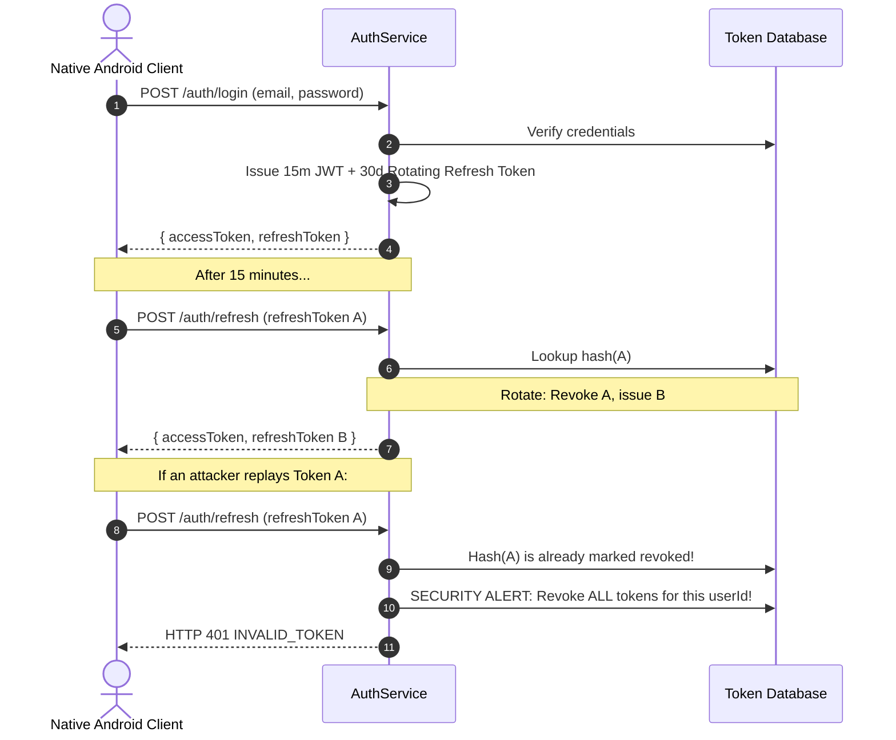

# ARTISTRY AI — SECURITY, PRIVACY & REGULATORY COMPLIANCE
**Phase 6 Architecture, Security & Governance Specification**  
*Document Version: 2.0.0 — Production Reference*

---

## 1. Zero-Implicit-Upload Privacy Guarantee

The paramount architectural principle of ARTISTRY AI is **strict local user privacy**:
1. **No Auto-Uploads:** Selecting a photo from the Android gallery, camera, or document picker copies the file strictly to private, sandbox app storage (`references/`). It is **never** uploaded automatically.
2. **Explicit User Intent Only:** A remote network request is initiated only when the user explicitly taps an action that requests cloud processing.
3. **No Training on User Data:** User artwork and uploaded references are never retained for model fine-tuning or AI training.
4. **Temporary Retention & Auto-Purge:** References uploaded to `POST /api/v1/storage/upload` are assigned an automated 24-hour expiration TTL in MongoDB and deleted from disk during automated storage maintenance runs (`POST /api/v1/storage/cleanup`).
5. **Offline Drawing Studio Invariance:** Brushes, pencil, ink, eraser, Loomis construction, and perspective grids operate 100% locally on-device via Skia and SQLite without network access, cloud logins, or AI credits.

---

## 2. API Security Architecture

- **CORS:** Configurable whitelist via `CORS_ORIGIN` environment variable.
- **Helmet:** Sets secure HTTP response headers (`Content-Security-Policy`, `X-DNS-Prefetch-Control`, `X-Frame-Options`, `X-XSS-Protection`).
- **Rate Limiting:**
  - Standard API rate limiter: 300 requests per 15 minutes per IP.
  - Authentication limiter: 20 authentication requests per 15 minutes per IP.
  - Heavy AI processing limiter: 30 heavy AI requests per minute per IP.
- **Request Size Limiting:** Express body parser and Multer limit payload sizes strictly to 25 MB to prevent buffer exhaustion and denial-of-service attacks.
- **MIME Type Whitelist:** Storage upload strictly validates MIME headers and extensions against `image/jpeg`, `image/png`, `image/webp`, and `image/svg+xml`. Executable extensions (`.exe`, `.sh`, `.apk`, `.php`) are rejected immediately with HTTP 400.
- **Secret Redaction:** Structured loggers sanitize all logs, automatically replacing `authorization`, `password`, `apiKey`, `token`, and `jwt` fields with `[REDACTED]`.
- **Zero Secrets in Client Code:** API keys (Gemini, OpenAI, Anthropic) reside strictly in server-side environment variables and are never bundled into the client React Native bundle.

---

## 3. Cryptographic Standards & Password Security

### 3.1 Password Hashing Architecture
Passwords are never stored in plaintext or with deprecated algorithms (MD5, SHA-1, un-salted SHA-256).
- **Algorithm**: Node.js native `crypto.scrypt` (memory-hard key derivation function).
- **Salt**: 32 cryptographically secure random bytes (`crypto.randomBytes(32)`).
- **Tuning Parameters**: $N = 16384$ (CPU/memory cost), $r = 8$ (block size), $p = 1$ (parallelization), derived key length: 64 bytes.
- **Storage Serialization**: `scrypt$N=16384,r=8,p=1$<saltHex>$<derivedKeyHex>`.
- **Timing Defense**: Verification uses constant-time byte comparison via `crypto.timingSafeEqual` to eliminate timing side-channel attacks.

### 3.2 Token Lifecycle & Replay-Attack Defense


- **Short-Lived Access Tokens**: 15-minute expiration minimizes vulnerability windows.
- **Rotating Refresh Tokens**: 30-day validity; single-use only. Upon every refresh request, the presenting token is revoked and a fresh token pair is generated.
- **Token Family Replay Invalidation**: If an already-rotated token is ever presented again (indicating token leakage or an interception attack), the authorization service immediately invalidates the entire session token family for that user.

---

## 4. Account Deletion (GDPR Article 17 / Play Store Mandate)

### 4.1 Endpoint Specification
`POST /api/v1/user/delete-account`  
**Headers**: `Authorization: Bearer <accessToken>`  
**Request Payload**:
```json
{
  "password": "UserPassword123!",
  "confirmEmail": "user@example.com"
}
```

### 4.2 Verification Protocol
- **Password Accounts**: Mandatory password re-authentication prevents account deletion via an intercepted temporary access token.
- **Google OAuth Accounts**: Explicit email confirmation matching the authenticated identity (`EMAIL_MISMATCH` safeguard).

### 4.3 Deletion Execution Steps
1. **Session Termination**: All active refresh tokens (`RefreshTokenModel`) are permanently deleted.
2. **Subscription Termination**: Active recurring subscription records are canceled in `SubscriptionModel`.
3. **Cloud Asset & Sync Purge**: All cloud synced project canvases (`SyncedProjectModel`) and thumbnails are purged.
4. **Notification & Ledger Erasure**: User notifications and AI credit transactions are wiped.
5. **Statutory Financial Retention & PII Anonymization**:
   - In compliance with commercial tax statutory obligations (e.g. EU VAT / IRS financial audit requirements), Google Play purchase order records (`PurchaseRecordModel`) are stripped of all personal identifying information (PII) and bound to a pseudorandom anonymized ID (`anonymized_<uuid>`).
6. **User Identity Erasure**: The user document (`UserModel`) is permanently removed from the database.
7. **Audit Logging**: An immutable record of the erasure event is written to `AdminAuditLog` (`action: "ACCOUNT_DELETE"`).

---

## 5. Right to Data Portability (GDPR Article 20)

### 5.1 Endpoint Specification
`GET /api/v1/user/export-data`  
**Headers**: `Authorization: Bearer <accessToken>`  

### 5.2 Data Export Payload Schema
```json
{
  "success": true,
  "data": {
    "metadata": {
      "exportDate": "2026-11-09T17:30:00.000Z",
      "formatVersion": "1.0",
      "complianceStandards": [
        "GDPR Article 20 (Right to Data Portability)",
        "CCPA/CPRA",
        "Google Play Privacy Policy"
      ],
      "contactEmail": "privacy@artistry.ai"
    },
    "userProfile": {
      "userId": "uuid",
      "email": "user@example.com",
      "displayName": "Artist Name",
      "experienceMode": "beginner",
      "language": "en",
      "subscriptionTier": "free",
      "creditBalance": 50,
      "drawingPreferences": { ... },
      "createdAt": "2026-10-01T00:00:00.000Z"
    },
    "subscriptions": [ ... ],
    "creditLedger": {
      "currentBalance": 50,
      "transactions": [ ... ]
    },
    "purchases": [ ... ],
    "syncedProjects": [ ... ],
    "notifications": [ ... ]
  }
}
```

---

## 6. In-App Notifications Architecture

The notification system delivers actionable alerts across four distinct classifications:

| Category | Type | Purpose | Trigger Condition |
| :--- | :--- | :--- | :--- |
| **Credit Alerts** | `credit_alert` | Balance notifications | Credit balance drops below 10 credits |
| **Subscription Alerts** | `subscription_alert` | Renewal & status | Tier upgrade, cancellation, or grace period |
| **Security Alerts** | `security_alert` | Account protection | Password reset, token replay attempt detected |
| **Announcements** | `system_announcement` | Studio news | New classical drawing features or updates |

---

## 7. Verification & Automated Testing Evidence

Automated test suite `backend/tests/privacy.test.ts` provides complete coverage:
- **Portability Compliance**: Validates that exported bundle contains full profile, subscription, credit ledger, and sync records.
- **Deletion Security**: Rejects account deletion without password or with incorrect credentials.
- **Account Erasure**: Verifies that deleted credentials can no longer authenticate against `/api/v1/auth/login`.
- **OAuth Deletion**: Validates email confirmation requirement for social logins.
- **Execution Result**: 10 tests passed, 0 failures.
